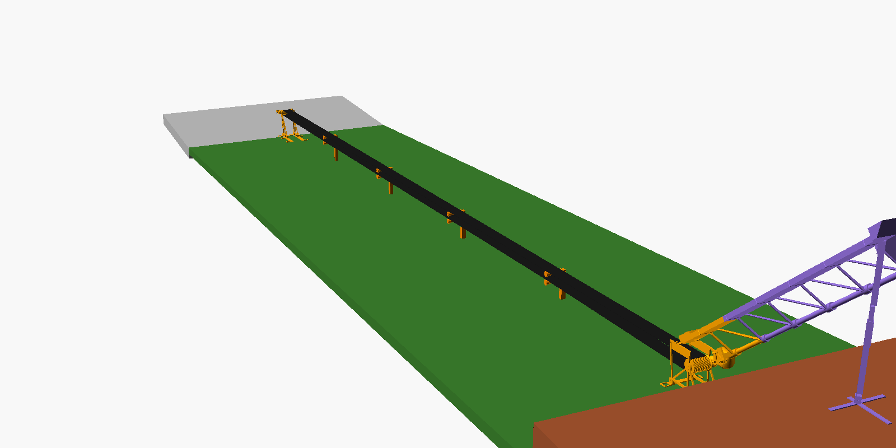
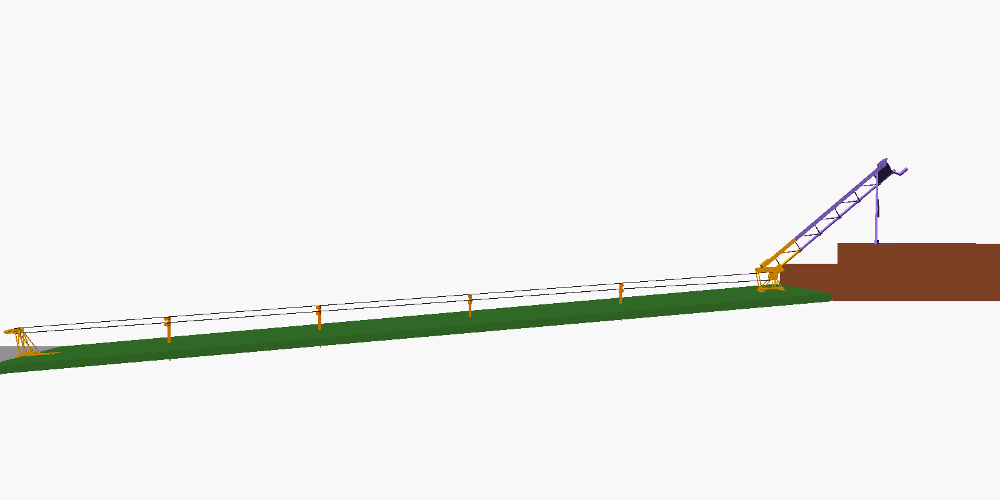
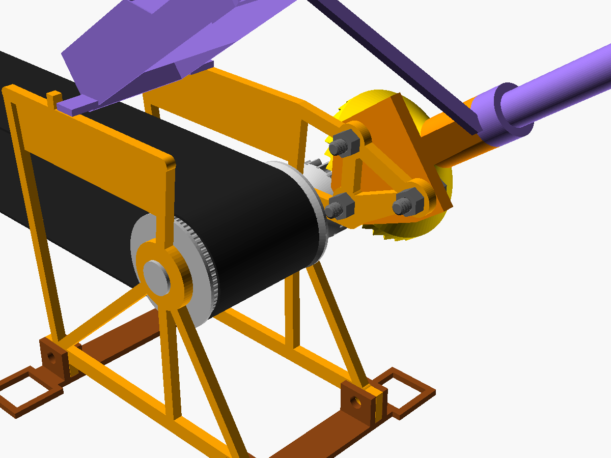
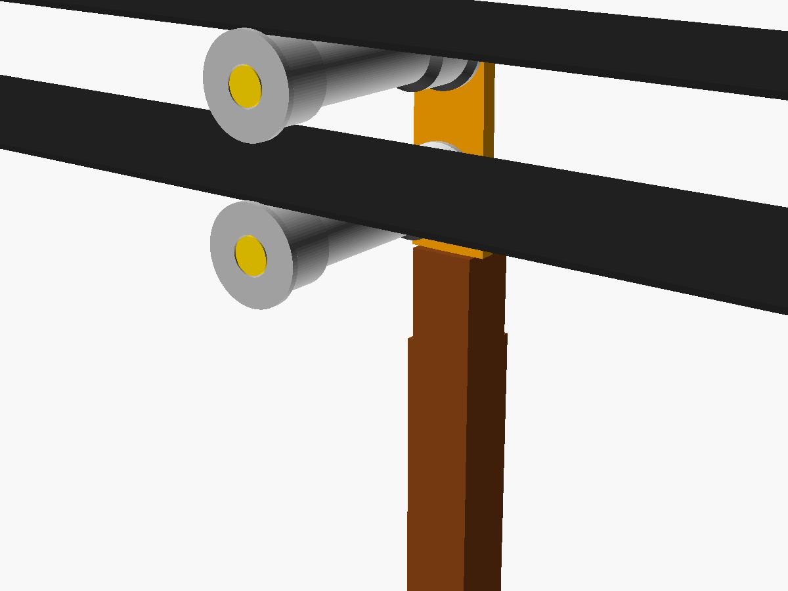
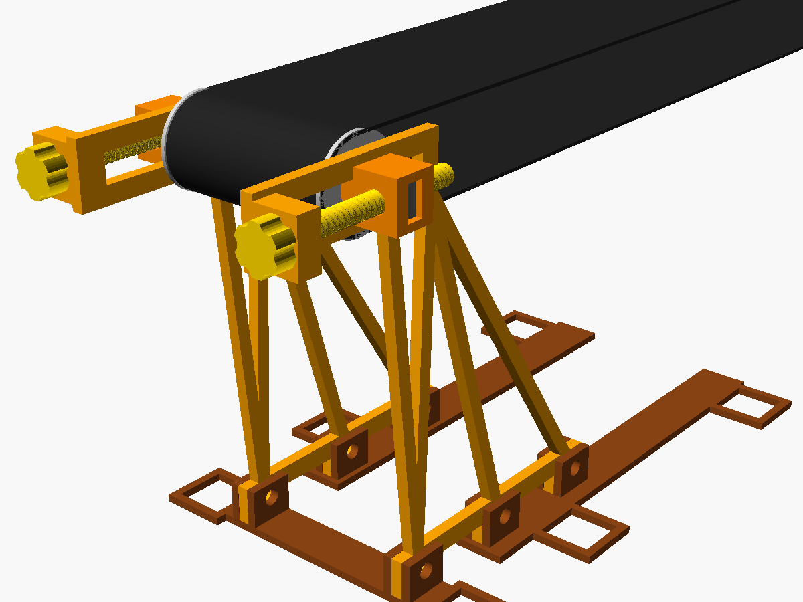
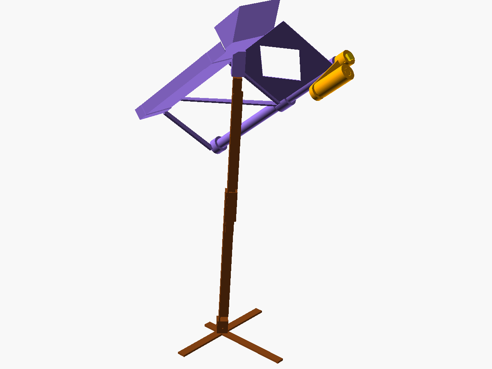

# Hand-cranked Halloween candy conveyor (v4: everything printed except the belt)

You drop candy into a funnel on the porch and turn a crank. The candy slides down a printed
chute over the steps and lands on a moving black belt about 6 in above the grass. The belt
carries it 20 ft down the lawn and tips it into a basket on the sidewalk. The belt comes back
underneath, like the moving walkway at an airport.

**The only thing you buy is the belt**: 3 in black polypropylene webbing, 50 yd roll,
<https://www.amazon.com/dp/B0BJ7X4THD>. Everything else is printed in PLA on a Bambu Lab P2S.
Sewing the belt into a loop takes a needle and strong thread you probably already have.





| Head (foot of the steps) | Station | Tail (sidewalk) | Porch end |
|---|---|---|---|
|  |  |  |  |

## Status: designed and computer-checked, NOT built or tested

| | |
|---|---|
| Parametric CAD (OpenSCAD) | ✅ `cad/conveyor.scad`, `cad/params.scad`, `cad/lib.scad` |
| Gearbox crown gear | ✅ generated by simulating the real pinion's motion (`cad/make_crown.py`) |
| STL files | ✅ `cad/stl/` (40 part files, already in print orientation) |
| Print plates | ✅ `plates/`: 18 ready-arranged P2S build plates (3MF), in build order; each plate's settings are in the [list](plates/plates.md) |
| Automated checks | ✅ every part renders, is watertight, fits the bed and prints without support (overhang scan); print-in-place gaps; every mating pair checked for overlap and clearance in its assembled position, including the chute over a model of your steps (`cad/check-report.txt`: all checks pass) |
| Whole machine assembled | ✅ every module placed on the site model (`cad/full_assembly.py` → `cad/full-assembly-report.txt`): feet and skids sit on the lawn and sidewalk within 2 mm, every stake goes 150 mm into the soil, the belt rides on every wheel and clears everything else by at least 8 mm, the return run stays 87 mm off the lawn, the loop measures 41.0 ft |
| Real slicer check | ✅ every part and every plate sliced with PrusaSlicer (the engine Bambu Studio is built on) on a P2S-like profile; every stability alert traced and fixed or explained; print-in-place gaps confirmed in the sliced G-code ([`cad/slice-report.md`](cad/slice-report.md), [`cad/gcode-gaps.md`](cad/gcode-gaps.md)) |
| Loads, belt length, stake lengths, crank effort | ✅ `calc/conveyor_calc.py` → `calc/report-2-risers.txt` |
| Physical prototype | ❌ **not built**. Friction, print fits and grip on the belt are estimates until you print the test coupon and the first module. |

**One measurement is still missing: the height of each porch step (riser).** The design
assumes 2 risers of 7 in. Measure from the top of one step to the top of the next before you
print the chute, the stakes and the stand (Quick start, step 3).

## How it works

| Part of the machine | What it does |
|---|---|
| **Crank + funnel** (porch) | Crank 110 mm long with a spinning grip, about 24 in above the porch floor. One turn = 2 turns of the drive roller. Stands on a printed 2-piece post with pinned height adjustment. **Tie the post to a railing, or put about 8 kg (two water jugs) on its foot**: cranking hard tips the stand sideways otherwise. |
| **Chute + drive shaft** (over the steps) | 5 printed segments. Each one is a candy chute with a print-in-place shaft running beside it. The segments stack together and hex couplers join the shafts. |
| **Drop trap** | Candy reaches about 3 m/s in the chute. It hits a wall under a lid and drops through a slot onto the belt. |
| **Head** (foot of the steps) | A 34-tooth crown gear (print-in-place in its housing) turns a 17-tooth pinion on the ribbed drive roller. |
| **4 stilt stations** (lawn) | Each one is a stake pushed into the grass with a bracket and two print-in-place wheels: the belt rides **over** the top wheel and comes back **underneath**, resting on the bottom wheel, as you asked. |
| **Tail** (over the sidewalk) | Print-in-place roller. Two screw take-ups set the belt tension and steer the belt straight. Candy drops off into the basket (rim at most 6 in high). |
| **Anchors** | Belt tension (about 40 N) has to go into the ground at both ends. Printed ground screws and L-spikes hold the head and tail feet. |

Effort: about **12 N (2.6 lbf) at the handle** dry, less if you rub candle wax on the bearings.
At 45 rpm the belt moves 0.3 m/s, so candy reaches the basket in about 20 s (15 turns).

## Quick start

1. **Order the belt today** (it decides the timeline).
2. **Print plate 1, `plates/01_test_coupon_etc.3mf`, first** (about 2 h). It tells you
   whether the print-in-place gap (0.45 mm) and the slip fits work on your printer.
   See [docs/03-printing.md](docs/03-printing.md).
3. **Measure your riser heights.** Put the height (inches) and the number of risers in
   `site_rise` and `site_risers` in `cad/params.scad`, run `python3 calc/conveyor_calc.py`,
   and copy the `seg_count`, `stand_h` and `stake_len` values it prints into the same file.
   Then run `python3 cad/check_parts.py` to regenerate and re-check every STL, and
   `python3 cad/make_plates.py` to rebuild the plates in `plates/` for your steps. The plate
   files carry their own copies of the parts, so without this step you would print the old
   ones. Without PrusaSlicer installed, use `python3 cad/make_plates.py --no-slice`.
4. Print the plates in order ([docs/03-printing.md](docs/03-printing.md): about 2.6 kg of PLA
   and roughly 85 h of printing) and build
   ([docs/04-build-and-setup.md](docs/04-build-and-setup.md)).

| Doc | |
|---|---|
| [01 Analysis and architecture](docs/01-analysis-and-architecture.md) | why it's built this way, loads, risks |
| [02 Shopping list](docs/02-shopping-list.md) | the belt, and the few household items |
| [03 Printing](docs/03-printing.md) | every part, settings, filament, order |
| [04 Build and setup](docs/04-build-and-setup.md) | step-by-step assembly, belt sewing, tensioning, Halloween night |

## Regenerating and re-checking

```
cd cad
python3 check_parts.py          # renders every part to stl/, runs all checks, writes check-report.txt
python3 make_crown.py           # (run by check_parts) crown gear + gearbox mesh check
python3 render_pictures.py      # assembly pictures in docs/img/ (needs xvfb-run)
python3 full_assembly.py        # the whole machine on the site: ground contact, belt path, overview pictures
python3 slice_all.py            # slices every part with PrusaSlicer, writes slice-report.md
python3 gcode_gaps.py           # print-in-place gaps in the sliced G-code, writes gcode-gaps.md
python3 make_plates.py          # lays the parts out on P2S plates, writes ../plates/ and the guide's plate table
cd ../calc
python3 conveyor_calc.py        # site values come from cad/params.scad; --svg <file> draws the side profile
```

Needs OpenSCAD 2021+ and Python 3 with `pip install trimesh manifold3d numpy networkx shapely`;
the slicer checks and plates also need PrusaSlicer 2.7+ on the PATH (`prusa-slicer`).
