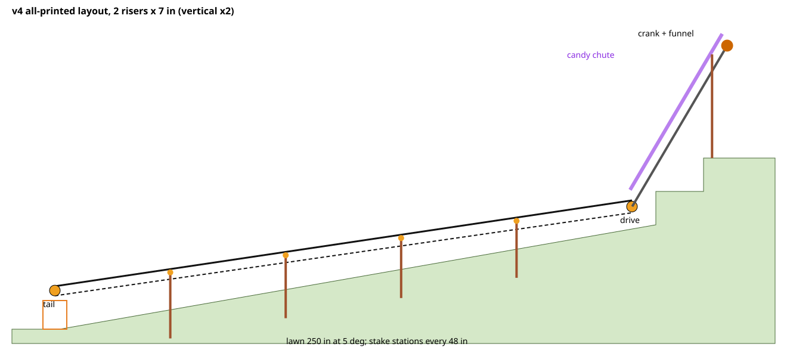

# Candy conveyor v4: analysis and design

Status: **designed and checked by computer; not yet built or physically tested.** The numbers
here come from [`../calc/conveyor_calc.py`](../calc/conveyor_calc.py) (site, loads) and
[`../cad/check_parts.py`](../cad/check_parts.py) (geometry, fits, clashes, printability). Both
read the same parameter file, [`../cad/params.scad`](../cad/params.scad).

## 1. What you asked for, and what changed

You asked for:

- a handle at the top that is easy to turn and moves the candy fast
- a belt about 6 in off the ground that drops candy into a basket and returns underneath
- small stilts with a wheel on top, the belt going over and under them
- gears at the top
- everything printed in PLA except the belt, as much as possible print-in-place
- coverage of 2 steps (20 in) plus 250 in of lawn at 5°

All of that is in the design, with three changes that make it work better than a literal
version:

| Your idea | What the design does | Why |
|---|---|---|
| Belt starts at the top of the steps | The **belt runs only along the lawn**. A printed **chute** brings the candy down the steps, and a **drive shaft** beside the chute brings your cranking down to the belt. | The steps are about 35° steep. Candy slides on a belt that steep, and where the steep part meets the lawn the belt would have to bend through a valley. Belt tension lifts a belt out of a valley, so it would need hold-down rollers right where the candy is. A chute handles a steep drop easily. |
| One wheel on each stilt | **Two** wheels on each stilt: the belt rides **over** the top one going down, and comes back underneath riding **over** the bottom one. | That keeps the return run off the grass. |
| "A couple of gears that make it move fast" | **One gear pair (2:1 step-up)**: a 34-tooth crown gear on the shaft drives a 17-tooth pinion on the drive roller. | 2:1 gives 0.3 m/s belt speed at a relaxed 45 rpm with 12 N at the handle. More step-up would make the crank harder to turn for little gain, because the belt's friction (not its speed) is what you feel. |

## 2. Site and layout (2 risers; 3 risers is in `calc/report-3-risers.txt`)

| Item | Value | Status |
|---|---|---|
| Lawn | 250 in at 5° (21.9 in of fall) | given |
| Steps | 20 in total run to the porch | given |
| Riser height | 2 x 7 in, so the porch is 35.9 in above the sidewalk | **ASSUMED: measure** |
| Belt | 20.2 ft axle to axle, 4.25° slope; belt top 6 in above the lawn at the head and 9 in above the sidewalk at the tail | |
| Drive roller (head) | 10 in before the first riser | |
| Tail roller | 2 in out over the sidewalk; the basket (rim no higher than 6 in) goes under it | |
| Stilt stations | 4, every 48.4 in; stakes pushed 150 mm into the lawn | |
| Chute | 40.3° to level, 5 segments; its underside clears the first step by 4.4 in | |
| Crank | 23.6 in above the porch floor, 9.9 in behind the porch edge (comfortable sitting on a porch chair) | |
| Porch stand | post 3.6 in behind the porch edge; socket 552 mm above the floor (adjustable +12 / -18 mm) | |
| Belt loop | 41.0 ft; cut 43 ft and sew it in place | |

For a higher crank, raise `--crank-min` in the calculator: it adds chute segments (5.3 in each)
and the stand grows to match. Two lower posts stack for stands taller than about 566 mm.

## 3. Loads (estimates, not measurements)

| Quantity | Dry PLA bearings | Waxed | Basis |
|---|---|---|---|
| Belt drag | 10.5 N | 6.9 N | tail roller V-bearing (μ 0.35 dry / 0.2 waxed, V-groove factor 1/sin45°), 8 station wheels, belt bending |
| Crank effort | **1.27 N·m = 12 N (2.6 lbf)** | 0.97 N·m = 9 N | drag x roller radius x 2 + journal friction, 85 % gear and 90 % shaft-line efficiency |
| Grip needed on the drive roller | μ ≥ 0.17 | μ ≥ 0.11 | capstan equation, 180° wrap, 20 N pretension per run; ribbed PLA on webbing is roughly 0.3 dry, 0.2 wet |
| Belt sag between stations | 14 mm light candy, 27 mm dense | | w·L²/8T over 1.23 m; the two runs are 44.6 mm apart at a station, so they never touch |
| Tension test | 100 g laid across the belt midway between stations: extra dip 11-12 mm at 25 N, 13-14 mm at 20 N, 15-18 mm at 15 N per run | | includes belt stretch (EA 10-55 kN, guessed) against the screw take-up |
| Speed | crank 45 rpm → belt 0.30 m/s; about 21 s from chute to basket | | |
| Candy speed at the bottom of the chute | 2.6-3.1 m/s | | sliding friction 0.3-0.45; the drop trap stops it |
| Tail tipping | 48 N uplift on the two rear skid ground screws (24 N each) | | 40 N belt pull acting 207 mm above the ground, 172 mm tipping arm |
| Head tipping | 28 N uplift on the front foot's two ground screws (14 N each) | | 120 mm height, 170 mm arm |
| Porch stand | about 7 N·m sideways from the hand on the crank | | 12 N at about 0.6 m: tie it down, add 8 kg, or hold the funnel |

**Torque path** (shear in MPa at the dry crank torque / twice it / a hard 30 N yank on the
handle; PLA across layers is roughly 20-30 MPa). Only the printed walls count: 4 walls make a
1.68 mm solid shell on every surface, and the 15 % sparse infill inside is ignored.

| Part | MPa |
|---|---|
| Line shaft tube Ø18/10 (4 walls) | 1.4 / 2.9 / 3.7 |
| Hex coupler, 11 mm across flats (solid) | 5.1 / 10.2 / 13.2 |
| Square drive, 12.4 mm (4 walls) | 3.3 / 6.6 / 8.5 |
| Gear teeth (Lewis, 2x) | 6.1 |
| Tail axle Ø12 (bending, 4-wall shell only) | 7.3 |

The weakest link is the hex coupler: about 4-6 times its strength at normal cranking, about 2
at a hard yank. It prints lying on a flat face, so no single layer runs right across it, and
one spare is printed.

## 4. Architecture

### 4.1 Belt: 3 in heavy polypropylene webbing (the only bought part)

| Option | Verdict |
|---|---|
| Rubber or neoprene strip | ❌ stretches about 8 % under tension, so it would never stay tight |
| PVC conveyor belting (the "tarp" kind) | ❌ only 4 in wide on Amazon, needs metal lacing |
| Nylon webbing | ❌ stretches when wet |
| **Country Brook 3 in heavy polypropylene webbing, 50 yd** | ✅ 76 x 1.7 mm, 2,100 lb, black, does not absorb water, can be sewn into a loop |

Polypropylene webbing barely stretches, so a fraction of a turn of the take-up changes the
tension a lot. The take-up is a fine screw (3 mm per turn) adjusted 1/8 turn at a time, and the
tension is set with the 100 g dip test (build guide, section 8).

### 4.2 Stations: stilts with two print-in-place wheels

Each station is an L-profile stake (printed lying flat, pushed 150 mm into the lawn) with a
socket on top. A bracket plugs into the socket and holds two **cantilevered print-in-place
wheel units**: the belt rides over the top one and comes back over the bottom one.

- **Wheels**: each is a spool with a 16 mm rim at each end, carrying the belt's edges. It spins
  on its axle on two 45° V-ridges with a 0.45 mm gap. The V shape holds the wheel on, takes
  side loads, and prints without supports.
- **Mounting**: the wheel's square peg goes through a 15 mm-long hole (bracket plus boss), and
  a pin pulls its collar tight against the bracket so it can't droop.
- **Stake lengths**: each station has its own, so the belt runs in a straight line. Stake 1 is
  284 mm long, stake 4 is 236 mm.

### 4.3 Head: drive roller and crown-gear gearbox

- **Drive roller**: Ø61.6 mm, crowned 0.3 mm (crowning centres the belt), 64 grip ribs, 2.5 mm
  flanges. The 17-tooth pinion (module 2.5) is part of the roller on side B. Side A runs on a
  separate journal pin, pressed in by crush ribs, with a flange to pull it out by.
- **Frames**: two flat lattice plates, 6 mm thick.
  - Frame B has an open slot for the roller journal, because the pinion is bigger than a round
    hole could pass. Belt tension and the gear force both push the journal into the closed end
    of the slot.
  - Above the belt, guard panels keep bouncing candy on the belt.
- **Gearbox (print-in-place)**:
  - A 34-tooth crown gear with its shaft, inside its housing, printed as one piece with a
    0.45 mm running gap. It bolts to frame B with 3 printed M8 bolts.
  - The crown teeth are **generated by simulating the real pinion rolling through the mesh**
    (`make_crown.py`, 816 positions).
  - The check finds no overlap at any position and 0.27 mm flank clearance, and the teeth engage
    within ±4° of pinion rotation.

### 4.4 Line: chute and drive shaft over the steps

Five identical segments, each printed standing up (229.5 mm tall). Each has:

- a **U-shaped candy chute**: 66 mm wide inside, 20 mm walls, with a socket at the lower end.
  The plain upper end of each piece goes 19.5 mm up into the socket of the piece above, which
  locks the pieces against turning on the shaft. The candy meets a 2 mm groove and a beveled
  edge at each joint.
- a **print-in-place drive shaft**: Ø18 mm hollow, with a V-ridge bearing in a ring at each end
  and an 11 mm hex socket at both ends. A thin tube from the bottom ring carries the top ring,
  so nothing starts printing in mid-air.
- two struts tying the rings to the chute.

Separate printed **hex couplers** join the shafts and **ring sleeves** line up the bearing rings.

The bottom of the line is a **drop trap**:
- An end wall and a lid stop the candy; there is 34 mm of headroom under the lid.
- The candy drops through a 60 mm floor slot onto the belt.
- The trap's upper end sits in segment 1's socket. Its ledges rest just above the head frames'
  guard bars, and a stop post on each frame stops it sliding downhill.

### 4.5 Crank head and porch stand

The crank head has the funnel (with a back wall leaning 50° so it prints), the top bearing pair,
and a 12.4 mm square drive for the crank arm. The arm (110 mm) has a print-in-place spinning
grip.

The porch stand:
- A world-vertical socket under the funnel takes the upper post, **pinned** so the crank head
  can't lift off when you crank.
- The upper post's long spigot slides into the lower post's deep socket. A pin through one of 6
  holes sets the height (+12 / -18 mm, 6 mm steps); the lower post is pinned into a
  cross-shaped tray. With the pin out, this joint collapses at least 35 mm from any hole, more than the 28 mm end
  spigots, so the stand goes in under (and comes out from under) a crank head that is already
  on the line.
- A porch high enough to need a stand over about 566 mm gets two lower posts, pinned end to end
  (every pin hole is 15 mm from its shoulder, so any lower post fits any other).
- The stand alone cannot resist the sideways push of cranking (about 7 N·m): tie it to a
  railing, add about 8 kg (two gallon jugs) on the tray, or hold the funnel rim while cranking.

### 4.6 Tail: print-in-place roller and screw take-up

The tail roller (Ø40 mm, crowned) turns on a fixed axle. The axle's square ends sit in square
sockets in two **take-up blocks** that slide in windows in the tail frames. A knob screw
(Ø10 mm, 3 mm pitch) on each side pulls its block toward the sidewalk through a square nut.
That gives 60 mm of travel. Turning one knob more than the other steers the belt.

The tail frames bolt to two **skids** that reach about 260 mm onto the lawn:
- Ground screws in their rear pads (about 70 mm in from the lawn edge) hold the tail down
  against the belt tension.
- Spikes in the far pads locate them.
- A foot crossbar ties the frames together at the sidewalk end.

### 4.7 Fasteners and anchors (all printed)

- **M8 bolts and nuts**: round 2 mm thread, printed standing, used for clamping only. The thread
  clearance is the `thread_gap` parameter.
- **Ground screws**:
  - Ø14 mm shaft with a 45° buttress flight, printed standing with the head down.
  - A printed bolt and 50 mm washer clamp a foot onto the head.
  - Driven with a printed T-wrench.
- **L-spikes** with nail heads, for the pads that are only pushed down.
- **Ballast**: the screws (or spikes) take the 40 N pull along the line. Weight can't do that
  on its own: on wet grass (friction about 0.4) it would take about 13 kg at the head and 8 kg
  at the tail. If your soil won't hold screws, push them in as pegs anyway (and spikes at the
  head's rear foot, or tie the head back to a step railing), then add weight against lifting:
  - about 5 kg on the tail's rear skid pads or rear foot crossbar
  - about 3 kg on the head's front foot

## 5. What was checked by computer

`cad/check_parts.py` writes `cad/check-report.txt`; all checks pass.

**Every part**
- It renders without warnings and the exported file is watertight.
- It has the expected number of bodies: print-in-place parts have 2, with a gap of at least
  0.30 mm.
- No layer starts in mid-air (island check every 0.2 mm). A print-in-place part may start
  up to 0.6 mm above another part, the same way a support interface does.
- No downward face flatter than 45° is wider than 12 mm, except flat bridges held by a wall on
  each side: those may span up to 20 mm (socket ceilings). No flat bridge is longer than 25 mm,
  except the trap's documented 66 mm one.
- It fits a 246 mm square on the P2S bed. Long stakes and posts are exported turned 45° to lie
  across the diagonal.

**Every part and every plate, in a real slicer** (`cad/slice_all.py`, `cad/gcode_gaps.py`,
`cad/make_plates.py`)
- Sliced with PrusaSlicer, the engine Bambu Studio is built on, using a P2S-like profile. Its
  stability alerts were traced to their spot in the G-code (`cad/gcode_support.py`). The real
  ones were fixed (section 7); the rest are explained in the printing guide.
- Print-in-place gaps measured in the sliced G-code: at least 0.43 mm between the plastic of
  the moving body and its housing, and no body printed onto another.
- Each of the 18 plates sliced as a whole: everything on the bed.

**Every mating pair, in its assembled position, with exact mesh booleans**
- **Slip fits**: journals, sockets and spigots, chute sockets, sleeves, hex couplers.
- **Bolts and pins**: gearbox bolts through the slab and frame; every stand pin through its
  holes.
- **Coupler grip**: hex couplers really grip; turned 15° in a socket they collide.
- **Chute joints**: each plain end sits deep in the next socket, and turning a piece 0.5°
  collides.
- **Clearances**:
  - belt to frames, trap and feet
  - candy space above the belt, and candy lanes through the trap, chute joints and crank head
  - crown gear to roller
  - basket space under the tail roller
- **Tail positions**: the take-up blocks and screws are checked fully in, middle and fully out.
- **Full crank turn**: the crank arm is swept around the funnel and past the stand posts.
- **Candy space**: the chute trough and the crank head's funnel have solid side walls and floor
  all along (sampled every 2.5 mm).
- **Site**: the chute line is checked against a model of your steps, and the stand foot against
  the porch edge and floor.

**Gear mesh**: checked in `make_crown.py`.

**The whole machine on the site** (`cad/full_assembly.py`, `cad/full-assembly-report.txt`):
every module is placed with the checker's transforms on the lawn, sidewalk and step model.
- The head feet and the tail skids and foot sit within 2 mm of the ground.
- Every stake goes 149-150 mm into the soil, as designed.
- The carry run touches every carry wheel and the return run every return wheel, and the belt
  clears everything else by at least 8 mm.
- The return run stays 87 mm above the lawn.
- The belt loop along this path is 41.0 ft, the same as the calculator's.

## 6. Risks, and what will tell you early

| Risk | How likely | Early warning / fix |
|---|---|---|
| Print-in-place parts fused | medium (depends on the printer) | **test coupon**: if the 0.45 mm spinner is stuck but 0.55 mm turns, set `pip_gap = 0.55` and re-export |
| Belt slips on the drive roller (wet) | medium | rub candle wax on the bearings (not on the roller); tighten 1/8 turn (stay within the 11-18 mm dip) |
| Belt walks off to one side | medium | crowned rollers centre it; steer with the two tail knobs (build guide) |
| Stand tips while cranking | high if left free | tie it to a railing, 8 kg on the tray, or hold the funnel |
| Stakes lean in soft lawn | medium | pre-soak, push straight; the belt load on each stake is under 10 N |
| Ground screws pull out | low-medium | 24 N each is needed; if they spin freely, leave them in as pegs and add weight against lifting (build guide, section 5) |
| A hex coupler breaks on a hard yank | low | crank smoothly; a spare is printed |
| Candy jams | low with fun-size candy | limits: about 30 mm thick, 110 mm long |
| Riser height different from 7 in | **certain to need checking** | measure and re-run the calculator **before printing the chute and stand** |

## 7. Independent review

After the first complete version, four independent reviewers (physics, printability, assembly,
consistency) went through the design and a fifth pass tried to refute each finding. They
confirmed 41 issues, overlapping, and all of them are fixed in this version. The serious ones:

- **Gearbox bolts**: 2 of the 3 bolts could not be fitted.
- **Chute joints**: the sockets did not receive the segment below, so segments could turn on
  the shaft.
- **Shaft couplers**: the 8 mm couplers were too weak, and the hollow shaft bore cut away the
  hex flats they grip.
- **Tension test**: the original test could not work, because the target dip was deeper than
  the gap between the belt runs.
- **Porch stand**: it could not hold the crank head down.
- **Printing**: the top bearing rings started printing in mid-air, and the stand socket
  intruded into the candy channel.
- **Drop trap**: it had only 20 mm of headroom.

Each now has an automated check (section 5), so it can't come back unnoticed. The full re-run
after the fixes caught three more problems, now fixed too:
- the tail roller's top flange cone was a loose sliver
- the crank grip started as a knife edge in mid-air (it now starts as a 3 mm flat ring)
- two exported STLs had a crack from float rounding

A second independent review (docs, build steps, printability, physics; each finding
re-checked by a skeptic) confirmed 18 more issues, all fixed:
- **Porch stand**: it still could not be fitted under a crank head already on the line. Its
  height joint now collapses at least 35 mm from any height hole. The 2-lower-post stand for tall porches now has matching
  pin holes and is modelled by the checker.
- **Crank head**: the stand socket started printing from a 1 mm² point on the plate; it now
  has a foot.
- **Ballast**: the fallback was sized only against tipping, not against the belt pulling the
  ends together. The guide now keeps pegs in the ground.
- **Drive roller**: the crown was not actually there; it is now 0.3 mm.
- **Tension test**: hanging the weight off one edge twisted the belt and over-read; the bag now
  lies across the middle.
- **Smaller fixes**: the top bearing ring's neck, the stake offset beside the string, the splice
  template (mark the holes, don't push a hot nail through PLA), and several numbers and
  quantities in the docs.

A third, focused review of those fixes confirmed 10 more (mostly wording). The main one: the
stand's height joint now collapses at least 35 mm from every height hole, not only the middle
one.

Then every part was put through a real slicer (section 5). That found:
- **Crank head funnel**: an earlier fix that kept the candy channel clear also cut away the
  funnel's flared side walls. That left a 20 mm open gap on each side, and walls above it
  starting in mid-air. Fixed, and the new candy-space check would catch it again.
- **Crank head web plate**: its lightening hole left thin, fragile strips. The plate is now
  solid (7 g more).
- **Wheel axles**: each stood 115 mm tall on 88 mm² of bed. It now has a foot giving 254 mm².
- **Pins and hex couplers**: they printed standing, so a single layer ran right across them.
  They now print lying down (the pins on a 0.3 mm flat), which is stronger and sticks better.
- **Shafts**: the chute, crank head and roller parts now print with 4 walls, so their shafts
  are close to solid.
