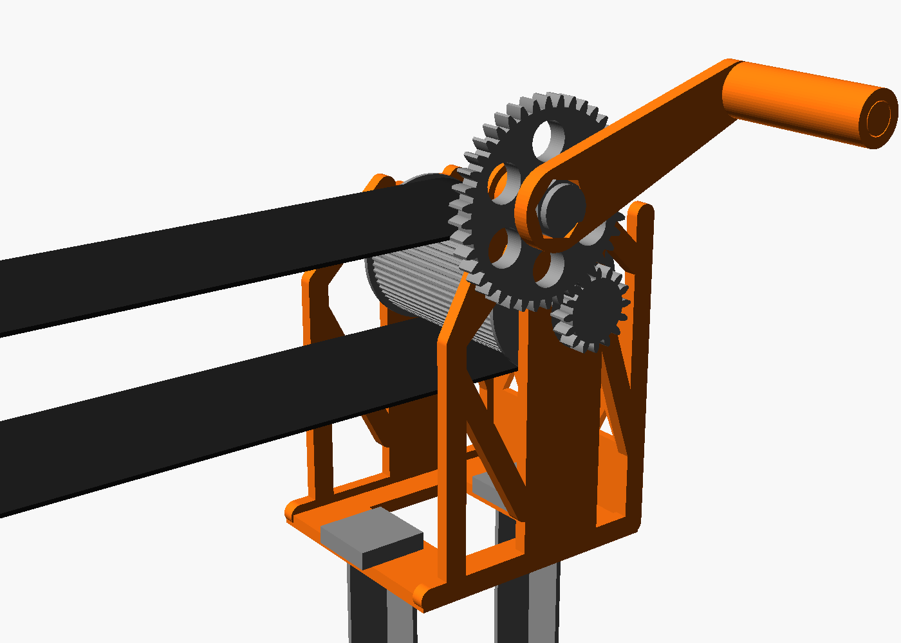
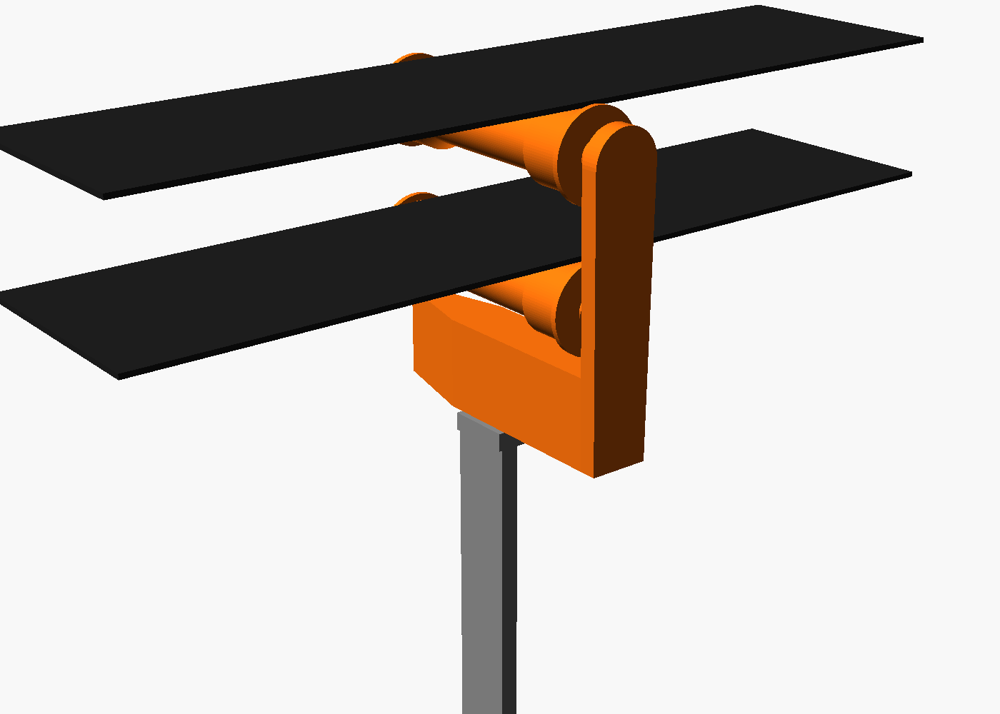
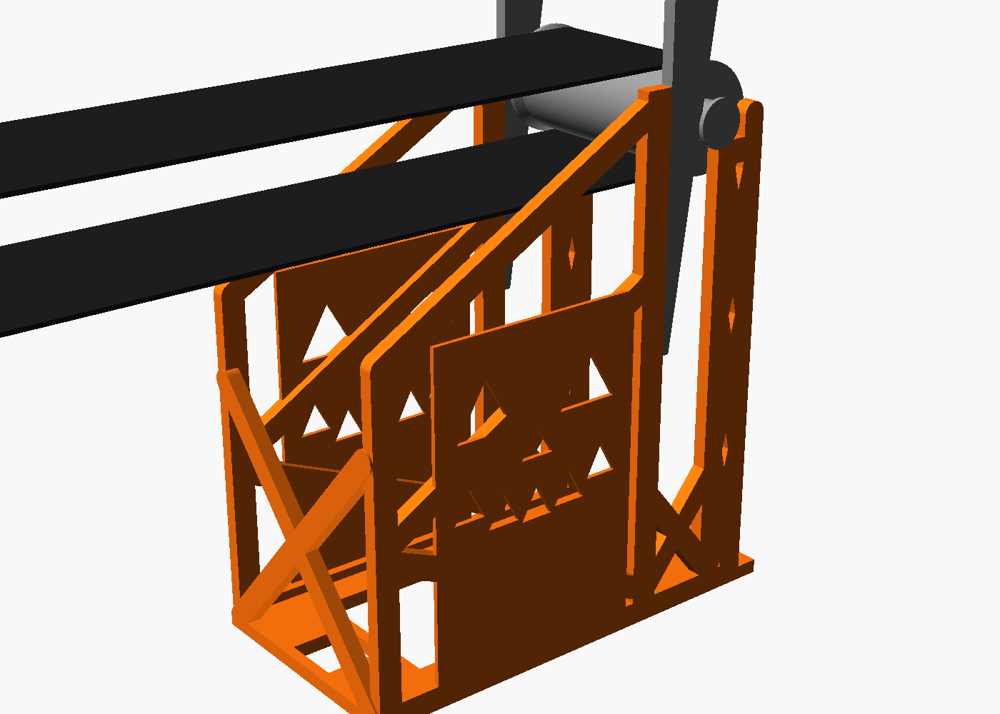

# SIMPLE candy conveyor: 21 printed parts, no bolts

A black belt carries candy from the foot of your porch steps, down 250 in of lawn, and drops
it into a basket on the sidewalk. You sit on the bottom step, put candy on the belt and turn
the crank. One turn a second moves the belt about half a metre a second, so a piece arrives in
about 12 seconds. The only thing you buy is the belt.

| Head (foot of the steps) | Station (3 on the lawn) | Tail (sidewalk) |
|---|---|---|
|  |  |  |

## What you print (21 pieces, 14 different)

| Piece | How many | What it does |
|---|---|---|
| `head_frame` | 1 | Holds the drive roller and the crank. A jack-o'-lantern faces you. |
| `drive_roller` | 1 | The ribbed roller that pulls the belt; its small gear is part of it. |
| `crank_gear` | 1 | Big gear (40 teeth): 2.5 turns of the roller per turn of the crank. |
| `crank_arm` | 1 | The handle. Its grip spins (printed in place). |
| `crank_pin` | 1 | Snaps through the arm and the gear into the frame and holds them on. |
| `tail_frame` | 1 | Holds the tail roller over the sidewalk edge. Pumpkin faces on both sides. |
| `tail_roller` | 1 | Turns the belt round at the sidewalk; candy drops off here. |
| `wedge` | 2 | Push them down to tighten the belt. |
| `journal_pin` | 2 | One pushes into the plain end of each roller. |
| `cassette` | 3 | Station wheels: the belt rides over the top wheel and comes back over the bottom one. Printed in place: they spin straight off the printer. |
| `station_stake_1/2/3` | 3 | Push into the lawn; a cassette sits on top. Each is a different length. |
| `anchor_stake` | 4 | Pin the head frame and the tail frame to the lawn (2 each). |

## Print

Open each plate in **its own new project** in Bambu Studio (File > New Project, then
File > Import), pick the P2S, 0.4 mm nozzle, your PLA and the textured PEI plate, set that
plate's settings, slice, print. Everything else stays at Bambu's defaults; **supports off**;
brim type **Outer brim only**. Infill pattern Gyroid (Rectilinear on the 100 % plate).

<!-- plates -->
| # | File | Parts | For | Settings | g | Time |
|---|---|---|---|---|---|---|
| 1 | `SIMPLE_01_wedge_etc.3mf` | 2 x `wedge`, `crank_pin`, 2 x `journal_pin` | crank, head, tail, tail | 3 walls, 100 %, 5 mm brim | 57 | 1h 16m 56s |
| 2 | `SIMPLE_02_tail_frame.3mf` | `tail_frame` | tail | 3 walls, 12 %, 5 mm brim | 277 | 8h 3m 35s |
| 3 | `SIMPLE_03_head_frame.3mf` | `head_frame` | head | 3 walls, 12 %, 5 mm brim | 182 | 5h 12m 4s |
| 4 | `SIMPLE_04_cassette_etc.3mf` | `crank_gear`, `drive_roller`, 3 x `cassette`, `tail_roller` | crank, head, stations, tail | 3 walls, 12 %, 5 mm brim | 432 | 14h 10m 5s |
| 5 | `SIMPLE_05_station_stake_1_etc.3mf` | `station_stake_1`, `station_stake_2`, `station_stake_3`, `crank_arm` | crank, stations | 4 walls, 30 % | 136 | 3h 21m 20s |
| 6 | `SIMPLE_06_anchor_stake.3mf` | 4 x `anchor_stake` | head, tail | 4 walls, 30 % | 109 | 2h 24m 45s |

All plates: **1.19 kg** of PLA.

About **34 hours** of printing in all.
<!-- /plates -->

Print plate 1 first (about an hour): it has the pins and wedges, so you can check the fits on
the bigger parts as soon as they come off.

**Slicer warnings you can ignore:**

| Part | Warning | Why it's fine |
|---|---|---|
| `crank_arm` | floating object, overhang | The spinning grip starts 0.45 mm above the arm on purpose. That gap is what lets it spin. |
| `cassette` | low bed adhesion, long bridges | The wheel axles stand on small feet (the brim holds them). The top plate bridges 23 mm between the axle collars. |
| `tail_frame` | collapsing overhang | A few 3-4 mm edges on the X braces. They print fine. |
| `tail_roller` | long bridges | Inside the roller, over its own infill. |

**After printing:** twist each cassette wheel and the crank grip firmly both ways to free them.
If one is stuck, dip it in warm water (45-50 °C) for a minute, let it cool, twist again.

## Buy

**Belt:** Country Brook Design 3 in Black Heavy Polypropylene Webbing:
<https://www.amazon.com/dp/B0BJ7X4THD>. The loop is about **41 ft**; cut **43 ft**. The
**25 yd** roll (75 ft) is enough if it has no factory splice in the first 43 ft.
Also: a needle and strong thread (or upholstery thread), a lighter, a tape measure, string.

## Build

1. **Head.** Stand the `head_frame` on the lawn at the foot of the steps, its pumpkin face
   toward the bottom step and about 6 in from the riser. Push 2 `anchor_stake`s through the
   square holes in its base, all the way in.
2. **Drive roller.** Push a `journal_pin` into the plain end of the `drive_roller` (a few taps,
   it is a press fit). Drop the roller into the two open slots, gear end on the side with the
   round boss.
3. **Crank.** Put the `crank_gear` on the boss (teeth meshing with the roller's gear), the
   `crank_arm` onto the gear's hex, then push the `crank_pin` through both into the frame until
   it clicks.
4. **Tail.** Stand the `tail_frame` on the lawn with its open end right at the sidewalk edge and
   push in 2 `anchor_stake`s. Push a `journal_pin` into the `tail_roller`, lower its ends
   through the two wedge windows and roll it back into the slots.
5. **Stations.** Stretch a string from the top of the drive roller to the top of the tail
   roller. Push `station_stake_1` in at 61 in from the sidewalk edge, `station_stake_2` at
   122 in, `station_stake_3` at 182 in, right under the string. Put a `cassette` on each stake
   (wheels toward the string) and push the stake down until the top wheel just touches the
   string. About 150 mm of each stake ends up in the ground.
6. **Belt.** Thread it over the drive roller, over each top wheel, round the tail roller, back
   over each bottom wheel and under the drive roller. Overlap the ends 75 mm on the bottom run,
   sew a box with an X through both layers, twice, and seal the cut ends with a lighter.
7. **Tighten.** Drop both `wedge`s into the windows in front of the tail roller, tip down, and
   push them down evenly until the belt is snug: a 100 g bag (20 nickels) laid across the
   middle of the belt between two stations should dip it **13-22 mm**. Turn the crank slowly
   and watch the belt at the tail: if it walks to one side, push that side's wedge down a little.
8. **Basket** on the sidewalk right under the tail roller. Its rim must be below 6 in.

If the ground is soft and a frame tips forward when you crank, put a brick on the end of its
base farthest from the belt's pull (about 5 kg).

**Take down:** pull the wedges, lift the belt off, pull the stakes. Nothing needs tools.

## Numbers (from `build.py`, all checked)

- Belt top 229 mm (9 in) over the sidewalk, 153 mm (6 in) over the lawn at the head;
  stations every 60.5 in.
- Cranking: about 12 N on the handle; one turn a second moves the belt 0.51 m/s.
- Heavy candy sags the belt 41 mm between stations; the top and return runs still stay
  13 mm apart.
- Gear teeth at twice the cranking torque: 12-14 MPa (PLA takes about 50 along the layers).
- Each frame's 40 N belt pull needs about 50 N from its rear anchor stake (or a 5 kg brick).

`build.py` renders every part and checks it (watertight, fits the bed, prints without supports,
nothing starts in mid-air, print-in-place gaps), the gear mesh over a full tooth, every part in
its module against every other part and the belt, and the whole line over your lawn
(`check-report.txt`). `make.py` slices every part and plate with the PrusaSlicer engine and
checks the print-in-place gaps in the G-code (`slice-report.md`, `gcode-gaps.md`).
